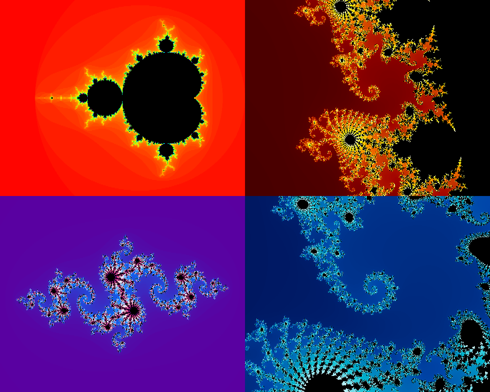

# amigamand

**A Mandelbrot and Julia set explorer for the Amiga.** It runs on AmigaOS 3.1 (68020 and up), draws in 256 colours on an AGA
machine (Amiga 1200, 4000), zooms with the mouse, is scriptable from ARexx, and saves its pictures as IFF ILBM.

*All four pictures were drawn by amigamand (hires, 256 colours) and saved as ILBM by its own `SAVE` option.*

- **Mandelbrot and Julia sets**, 1 to 255 iterations, five palettes with colour cycling
- **AGA**: 256 colours, hires and interlace; falls back to fewer colours by itself on OCS/ECS; PAL and NTSC
- **Two programs**: `amigamand` (fixed point, runs on any 68020) and `amigamand-fpu` (68881/68882/68040+, deeper zoom)
- **ARexx port** `AMIGAMAND`, **IFF ILBM** saving, ASL file and screen mode requesters, Workbench icon with tool types
- **Fast**: the pixel loop is hand-written 68020 assembly, the screen is written bitplane by bitplane by its own
  chunky-to-planar routine, and symmetry and region filling skip work that is not needed
- **Tested**: a 15-test suite drives the real programs in an emulator and checks the pictures pixel for pixel

## Quick start

The two programs, `amigamand` and `amigamand-fpu`, and their icons are in the repository, ready to copy to an Amiga or a disk
image. To try them on a Mac with [FS-UAE](https://fs-uae.net):

    git clone https://github.com/Shadester/amigamand && cd amigamand
    ./run                 # starts amigamand in an emulated A1200

`./run` needs FS-UAE, and your own Kickstart 3.1 A1200 ROM and Workbench 3.1 disk image in `~/Documents/FS-UAE` (they are not
part of this repository). `./run MODE 0 ITER 255` passes start options, `./run fpu JULIA` runs the FPU build.
`tools/setup.sh check` says what is missing.

## Using it

**Mouse.** Left click centres the view on that point. Left drag draws a box and zooms into it. The right button opens the menu
(the Right-Amiga shortcuts work too).

**Keys.**

| key | does |
|---|---|
| `+` `-` | zoom in, out |
| cursor keys | pan a quarter of the picture |
| `0` | reset the view |
| `j` | the Julia set of the point you clicked last |
| `m` | back to the Mandelbrot set |
| `r` | redraw |
| `s` | save as ILBM (opens a file requester) |
| `c` | cycle the colours |
| space | stop a render |
| Esc | quit |

**Menu.** *Project*: redraw, abort, save, quit. *View*: zoom, reset, Mandelbrot, Julia. *Mode*: lores, hires, hires interlace, or
"Other..." for any screen mode the machine has. *Palette*: Rainbow, Fire, Ocean, Gray, Electric, and cycle colours. *Detail*: 64,
128 or 255 iterations, and fast fill.

A picture is drawn coarse first, then refined, so you see where you are going before it is finished.

### Start options

From a Shell, or as tool types in the icon (the icon has them ready; those in brackets are switched off):

    amigamand [MODE n] [CX x] [CY y] [SPAN s] [ITER n] [PALETTE name] [JULIA] [JR x] [JI y]
              [SAVE file] [QUIT] [EXACT] [DEPTH n]

| option | meaning |
|---|---|
| `MODE` | 0 lores, 1 hires (default), 2 hires interlace. 320x256, 640x256, 640x512 on PAL; 200 and 400 lines on NTSC |
| `CX CY SPAN` | the centre of the view and its width, for example `CX -0.7436 CY 0.1318 SPAN 0.02` |
| `ITER` | at most this many iterations, 1 to 255 (default 128) |
| `PALETTE` | `Rainbow`, `Fire`, `Ocean`, `Gray`, `Electric`, or 0 to 4 |
| `JULIA`, `JR`, `JI` | show the Julia set of the constant JR + JI i (default -0.8 + 0.156i) |
| `SAVE`, `QUIT` | save an ILBM when the first picture is finished, and quit |
| `EXACT` | no fast fill (see *How it is fast*) |
| `DEPTH` | bitplanes, 1 to 8. Fewer planes: fewer colours, less video DMA, faster on a stock A1200 |

`SAVE` and `QUIT` make it a batch tool:

    amigamand MODE 1 CX -0.7453 CY 0.1127 SPAN 0.006 ITER 255 PALETTE Ocean SAVE RAM:sea.iff QUIT

### ARexx

The port is `AMIGAMAND`:

    /* zoom into the spiral and save it */
    options results
    address AMIGAMAND
    'ITER 255'
    'PALETTE fire'
    'ZOOM -0.7436 0.1318 0.02'
    'WAIT'                      /* returns when the picture is finished */
    'SAVE RAM:spiral.iff'
    'QUERY'                     /* the view, as a result string */
    say result
    'QUIT'

| command | |
|---|---|
| `RENDER`, `ABORT`, `WAIT`, `RESET` | draw again, stop, wait until finished, default view |
| `ZOOM cx cy span`, `CENTER x y`, `SPAN s` | set the view |
| `MODE n`, `ITER n`, `PALETTE name\|n`, `CYCLE ON\|OFF`, `FAST ON\|OFF` | settings |
| `JULIA [re im]`, `MANDELBROT` | which set |
| `SAVE file` | write an ILBM |
| `QUERY` | returns `MANDELBROT cx cy span iterations WxHxplanes palette DONE ticks` (or `RENDERING`) |
| `QUIT` | |

An unknown command or a bad argument returns 10.

### Saved pictures

ILBM with the real palette, ByteRun1 packing, and the screen mode ID in `CAMG`, so a viewer opens it in the mode it was drawn in.

## Building

You need a C compiler for the host and the Amiga cross compiler vbcc with vasm, vlink and the NDK headers. `tools/setup.sh`
downloads and builds them into `toolchain/` inside the repository (about two minutes, nothing is installed elsewhere), and
checks every download against a SHA-256:

    tools/setup.sh        # needs cc, make, curl, tar and lha (macOS: brew install lhasa)
    make                  # amigamand and amigamand-fpu

The programs are committed, and a rebuild gives the same bytes.

`tools/make_icon.py` writes the two `.info` files. `tools/run.sh` boots a whole Workbench in FS-UAE with the programs and icons
on a volume `AMIGAMAND:`. `CPU=68020 FPU= ./run` is a stock A1200; the default is a 68040, the fastest emulated machine that
makes a difference.

## Tests

    tools/test/test.sh

takes about ten minutes and boots the real programs in FS-UAE. It checks the pens of five views against stored hashes, that
fast fill and the periodicity check draw what plain iteration draws, the interlace, NTSC and 5-plane modes, the FPU build (and
its clean exit without an FPU), keys, menu shortcuts, colour cycling, abort, both ASL requesters, saving, the mouse handlers,
the icon (loaded by the real `icon.library`), the Workbench tool types and the real ARexx. `tools/test/README.md` has the list.

## How it is fast

Ticks of 1/50 s for one picture on an emulated stock A1200 (68020, no fast RAM), against the first working version:

| picture | first | now |
|---|---|---|
| the whole set, hires, 128 iterations | 1309 (26 s) | 680 (14 s) |
| the spiral, lores, 255 iterations | 6964 (139 s) | 3953 (79 s) |
| a Julia set, hires | 3496 (70 s) | 1160 (23 s) |

On an accelerated machine, or in FS-UAE with a 68040, the same pictures take a second or two. What made the difference, in the
order it paid:

- **Own chunky-to-planar conversion** straight into the screen's bitplanes. graphics.library's `WriteChunkyPixels` is a generic
  routine on AGA and cost 30% of a frame on a 68020, and most of the time on faster CPUs.
- **The whole pixel loop in assembly**, one call for each row, with z and c in Q4.28 and the high long of `muls.l` giving the
  squares directly. A call for every pixel cost more than the few iterations most pixels need.
- **Symmetry.** The set is mirrored about the real axis; every Julia set is the same turned half way round. Half the work.
- **Skipping the obvious.** Points outside radius 2, and inside the main cardioid and the period-2 bulb, are known without iterating.
- **Fast fill** (Mariani-Silver) when zoomed in: if the border of a rectangle is one colour, so is its inside. And a **periodicity
  check** that stops iterating an orbit that has come back to itself. Both switch themselves off where they do not pay.

`CLAUDE.md` has the full account, including what was tried and did not work (an exact periodicity check cannot fire in fixed
point; a cheaper two-multiply loop cannot give the same pictures).

On a stock A1200 the CPU shares chip RAM with the video DMA: a 256-colour hires screen is about 40% slower than the same work
with 2 bitplanes (`DEPTH 2`). Any fast RAM removes that.

## Limits

- Fixed point has 24 bits of fraction, so below a span of about 1e-4 the picture turns blocky. Use `amigamand-fpu`.
- Fast fill and the periodicity check are heuristics (a region is taken to be one colour when its border is, an orbit to be
  periodic when it returns close to itself). They matched plain iteration pixel for pixel in every test; `EXACT` switches the fill off.
- Developed and tested in FS-UAE only. The mouse itself, the buttons of the screen mode requester and the icon on a real
  Workbench could not be tried; nobody has run it on a real Amiga yet.

## Layout

| file | |
|---|---|
| `main.c` | the user interface, rendering control, requesters, ARexx commands, start options |
| `view.c`, `view.h` | the view, the number type (Q8.24 or `double`), the loops |
| `iter020.s` | the fixed-point pixel loop |
| `c2p.c` | chunky to planar |
| `palette.c`, `ilbm.c`, `rexx.c` | palettes, IFF ILBM writer, the ARexx port |
| `run`, `tools/` | the run script, setup, icon generator, the test suite |

## Licence

None has been chosen yet, so by default all rights are reserved. Ask, or open an issue.
